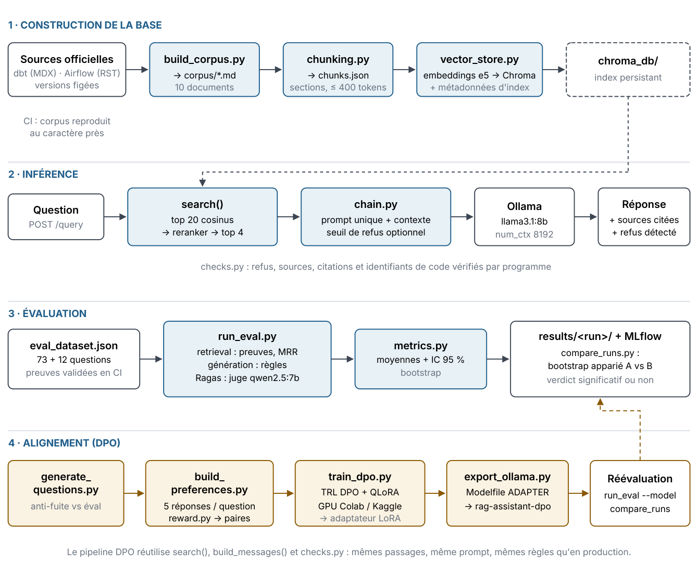

# 3. Vue d'ensemble

Le système est un ensemble de scripts Python indépendants qui communiquent par des fichiers (corpus, chunks, index, résultats, paires de préférences, adaptateur). Ce choix rend chaque étape exécutable, testable et inspectable isolément.

## 3.1 Les quatre chaînes



*Figure 2. Les quatre chaînes du système et les fichiers qui les relient. En bleu : modules exécutés en local ; en ocre : pipeline d'alignement.*

Un principe traverse le projet : **une seule définition de chaque chose**. Le prompt est défini une fois (`build_messages`) et utilisé par l'inférence, l'évaluation et l'entraînement. Les règles de vérification sont définies une fois (`checks.py`) et servent à la fois de métriques d'évaluation et de récompense DPO. La recherche est définie une fois (`search`) et alimente l'API, l'évaluation et la génération des paires. Si ces trois usages divergeaient, on entraînerait le modèle sur une situation différente de celle qu'on évalue et de celle qu'on sert.

## 3.2 Artefacts et flux de données

|Artefact|Produit par|Consommé par|Versionné ?|
|---|---|---|---|
|`corpus/*.md`|`build_corpus`|`chunking`, `dataset`|Oui ; la CI vérifie qu'il se reconstruit à l'identique.|
|`ingestion/chunks.json`|`chunking`|`vector_store`, `generate_questions`|Non (dérivé) ; construit dans l'image Docker.|
|`chroma_db/`|`vector_store`, API|`search()`|Non ; volume Docker.|
|`evaluation/eval_dataset.json`|Rédigé à la main|`run_eval`, anti-fuite|Oui ; preuves validées en CI.|
|`evaluation/results/<run>/`|`run_eval`|`compare_runs`|Au choix (runs de référence).|
|`mlruns.db`|`mlflow_tracking`|`mlflow ui`|Non.|
|`training/data/questions.jsonl`|`generate_questions`|`build_preferences`|Non.|
|`training/data/preferences.jsonl`|`build_preferences`|`train_dpo` (Colab)|Non.|
|`training/outputs/dpo-lora/`|`train_dpo`|`export_ollama`|Non.|

## 3.3 Organisation du dépôt

```
assistant-rag/
├── config.py                    configuration centrale (variables d'environnement)
├── corpus/                      10 documents Markdown reconstruits depuis les sources
├── ingestion/
│   ├── build_corpus.py          MDX / reStructuredText → Markdown (versions figées)
│   ├── chunking.py              découpage par sections, fil d'Ariane
│   └── embeddings.py            embeddings multilingues + reranker
├── retrieval/vector_store.py    ChromaDB, reranking, métadonnées et fraîcheur de l'index
├── rag_chain/
│   ├── chain.py                 prompt unique, génération, seuil de refus, mémoire de conversation
│   ├── checks.py                vérifications déterministes des réponses
│   ├── complements.py           mises en garde vérifiées (expérimental)
│   ├── nli.py                   modèle NLI partagé (récompense DPO, compléments)
│   └── tracing.py               traçage Langfuse optionnel
├── api/
│   ├── main.py                  FastAPI : POST /query, GET /health, interface sur /
│   └── static/index.html        interface web de test
├── evaluation/
│   ├── eval_dataset.json        85 questions avec preuves
│   ├── conversations.json       18 relances pour mesurer la mémoire
│   ├── dataset.py               chargement et validation contre le corpus
│   ├── metrics.py               métriques, bootstrap, seuil
│   ├── run_eval.py              boucle d'évaluation + MLflow
│   ├── run_conversation_eval.py recherche avec relance brute, reformulée, complète
│   ├── compare_runs.py          comparaison appariée de deux runs
│   ├── mlflow_tracking.py       journalisation MLflow
│   ├── _ragas_compat.py         correctif d'import ragas / langchain-community
│   └── results/                 runs de référence (v1, baseline_v2, memoire_v1)
├── training/
│   ├── reward.py                récompense vérifiable
│   ├── generate_questions.py    questions d'entraînement + anti-fuite
│   ├── out_of_scope_train.json  60 questions hors périmètre d'entraînement
│   ├── build_preferences.py     paires chosen / rejected, reprise après interruption
│   ├── select_pairs.py          re-sélection des paires sans régénérer
│   ├── sample_pairs.py          échantillon de paires à relire
│   ├── train_dpo.py             DPO + QLoRA (TRL)
│   ├── dpo_colab.ipynb          notebook d'entraînement GPU
│   ├── export_ollama.py         adaptateur ou modèle fusionné → Ollama
│   └── README.md                procédure pas à pas
├── tests/                       66 tests (sans modèle ni GPU)
├── langfuse/                    serveur Langfuse local (Docker Compose)
├── docs/                        ce wiki et le PDF généré
├── .github/workflows/           ci-cd.yml, training-smoke.yml
├── Dockerfile, docker-compose.yml, .dockerignore
├── pyproject.toml               configuration ruff et pytest
└── requirements.txt, requirements-dev.txt, requirements-train.txt
```

Environ 4 700 lignes de Python (tests compris) et 30 000 mots de corpus.

## 3.4 Stack technique

|Brique|Outil|Rôle et raison du choix|
|---|---|---|
|Générateur|Ollama + `llama3.1:8b`(Q4_K_M)|Gratuit, local, tient sur un GPU de 8 Go. Ollama gère la quantification, le gabarit de chat et une API HTTP.|
|Juge d'évaluation|Ollama + `qwen2.5:7b`|Famille différente du générateur, pour limiter le biais d'auto-évaluation.|
|Embeddings|`intfloat/multilingual-e5-small`|Multilingue (questions FR, corpus EN), petit (384 dimensions), tourne sur CPU.|
|Reranker|`cross-encoder/mmarco-mMiniLMv2-L12-H384-v1`|Cross-encodeur multilingue entraîné sur mMARCO (MS MARCO traduit), léger.|
|Base vectorielle|ChromaDB 1.5 (client persistant)|Sans serveur, fichiers locaux, métadonnées par collection.|
|Orchestration|LangChain (LCEL), `langchain-ollama`|Composition prompt → LLM → parseur ; découpeur de texte récursif.|
|API|FastAPI + Uvicorn, Pydantic|Validation des entrées, documentation Swagger automatique, cycle de vie (indexation au démarrage).|
|Évaluation|Ragas 0.4.3, numpy, pandas|Métriques sémantiques standard ; le reste est calculé par le projet.|
|Suivi|MLflow 3 (backend SQLite)|Historique des runs, paramètres, métriques, artefacts.|
|Alignement|TRL 1.15, PEFT 0.21, bitsandbytes, transformers 5.19|Implémentation de référence de DPO, LoRA/QLoRA.|
|Récompense NLI|`MoritzLaurer/mDeBERTa-v3-base-xnli-multilingual-nli-2mil7`|NLI multilingue pour le score de grounding.|
|Qualité|pytest, ruff|Tests sans modèle, lint et tri des imports.|
|Déploiement|Docker, GitHub Actions, GHCR|Image de l'API, CI/CD, registre d'images gratuit lié au dépôt.|

## 3.5 Configuration centrale

`config.py` lit toutes les valeurs depuis les variables d'environnement (fichier `.env` chargé par `python-dotenv`), avec des valeurs par défaut. Aucun autre module ne lit l'environnement directement : changer de modèle ou de taille de chunk se fait à un seul endroit, sans toucher au code. La fonction interne `_optional_float` transforme une variable vide en `None` (utilisée pour le seuil de refus, désactivé par défaut).

|Variable|Défaut|Rôle|
|---|---|---|
|`OLLAMA_BASE_URL`|`http://127.0.0.1:11434`|Serveur Ollama (port modifiable si réservé par Windows).|
|`OLLAMA_LLM_MODEL`|`llama3.1:8b`|Générateur. Devient `rag-assistant-dpo` si le DPO est adopté.|
|`OLLAMA_NUM_CTX`|`8192`|Fenêtre de contexte demandée à Ollama.|
|`JUDGE_LLM_MODEL`|`qwen2.5:7b`|Juge Ragas, rédacteur des questions d'entraînement.|
|`EMBEDDING_MODEL_NAME`|`intfloat/multilingual-e5-small`|Modèle d'embeddings.|
|`EMBEDDING_QUERY_PREFIX` / `_PASSAGE_PREFIX`|`"query: "` / `"passage: "` si E5, sinon vides|Préfixes asymétriques.|
|`CHUNK_SIZE_TOKENS`|`400`|Taille maximale d'un chunk (tokens du tokenizer d'embeddings).|
|`CHUNK_OVERLAP_TOKENS`|`50`|Chevauchement lors du recoupage d'une longue section.|
|`CHROMA_PERSIST_DIR`|`./chroma_db`|Dossier de l'index.|
|`CHROMA_COLLECTION_NAME`|`dbt_airflow_docs`|Nom de la collection.|
|`TOP_K`|4|Passages transmis au LLM.|
|`RETRIEVAL_CANDIDATES`|`20`|Candidats de la recherche vectorielle avant reranking.|
|`RERANKER_MODEL_NAME`|mmarco-mMiniLMv2 (vide = désactivé)|Cross-encodeur.|
|`RELEVANCE_THRESHOLD`|vide (désactivé)|Refus sans appel au LLM si le meilleur score est inférieur.|
|`MLFLOW_TRACKING_URI`|`sqlite:///mlruns.db`|Backend MLflow.|
|`MLFLOW_EXPERIMENT_NAME`|`rag-genai-eval`|Expérience MLflow.|
|`EMBEDDING_DEVICE`|vide (automatique)|`cpu` pour laisser la mémoire du GPU à Ollama pendant `build_preferences.py`.|
|`HISTORY_MAX_TURNS`|`3`|Échanges de l'historique pris en compte (section 20.3).|
|`COMPLEMENTS_MAX` / `_MIN_SCORE` / `_MIN_ENTAILMENT`|`3` / `0` / `0.5`|Compléments : nombre maximal, score du reranker, implication NLI (section 20.4).|
|`LANGFUSE_PUBLIC_KEY` / `_SECRET_KEY` / `_BASE_URL`|vides|Traçage Langfuse ; désactivé sans clés ou avec `LANGFUSE_TRACING_ENABLED=false` (section 20.1).|

Constantes de chemins (non surchargeables) : `ROOT_DIR`, `CORPUS_DIR`, `CHUNKS_PATH`, `TRAINING_DIR`, `TRAINING_DATA_DIR`. Côté Docker, `OLLAMA_BASE_URL_DOCKER` (défaut `http://host.docker.internal:11434`) et `HOST_PORT` (défaut 8600) sont lus par `docker-compose.yml`.

> [!NOTE]
> **CE QU'ON AURAIT PU FAIRE**
>
> - **pydantic-settings** : une classe `Settings` typée et validée (erreur claire si `TOP_K=abc`). Plus robuste, au prix d'un objet à passer partout.
>
> - **Fichier YAML de configuration + Hydra** : pratique pour lancer des grilles d'expériences (taille de chunk × modèle × top-k). Surdimensionné pour ce projet.
>
> - **Packaging Python** (un paquet installable avec `pip install -e .`) : supprimerait les `sys.path.insert` en tête de chaque script, un raccourci volontaire pour garder des scripts lançables directement.
