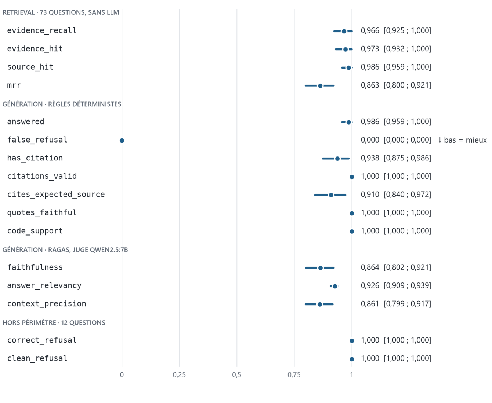

# 19. Résultats mesurés et état d'avancement

Ce chapitre rend compte de la première exécution réelle de la V2, les 12 et 13 octobre 2026, sur une machine Windows avec Ollama : la mise en route, les résultats de la baseline, l'analyse des échecs, les défauts que seule l'exécution a révélés, et l'état du pipeline DPO. Tous les chiffres viennent de `evaluation/results/baseline_v2/` (commit `4153245`) et du run MLflow associé.

## 19.1 Mise en route : une configuration restée en V1

Le code était prêt, la machine ne l'était pas. Le fichier `.env`, non versionné, datait de la V1 et contredisait `.env.example` sur trois lignes :

|**Variable**|**Valeur trouvée**|**Valeur V2**|**Conséquence observée**|
|---|---|---|---|
|`OLLAMA_BASE_URL`|port 12600|port 11434|Connexion refusée (_WinError 10061_) à la première génération : Ollama écoutait sur 11434.|
|`EMBEDDING_MODEL_NAME`|all-MiniLM-L6-v2|`multilingual-e5-small`|Index non multilingue ; 110 chunks sur 166 tronqués à l'encodage (limite de 256 tokens).|
|`CHUNK_SIZE_TOKENS`|500|400|Chunks plus longs que ce que le modèle d'embeddings sait encoder.|

S'y ajoutaient deux modèles Ollama absents (`llama3.1:8b` et `qwen2.5:7b`), un index ChromaDB hérité de la V1 (126 chunks, sans métadonnées) et l'absence de `chunks.json`. Deux garde-fous du chapitre 7 ont joué leur rôle : `ensure_index_ready` a refusé l'ancien index au lieu de servir des résultats issus d'un autre corpus, et `count_truncated` a signalé les 110 chunks tronqués. Après correction, le chunking produit **207 chunks** (médiane 311 tokens, maximum 400), dont aucun n'est tronqué.

> [!TIP]
> **CE QU'ON AURAIT PU FAIRE**
>
> **Valider la configuration au démarrage** : une classe `pydantic-settings` et un contrôle explicite (Ollama joignable, modèles présents, modèle d'embeddings cohérent avec l'index) auraient remplacé une trace d'erreur de 80 lignes par un message d'une ligne. Le fichier `.env` n'étant pas versionné, rien ne le fait évoluer avec le code : c'est le point faible de toute configuration par variables d'environnement.

## 19.2 La baseline V2

Commande : `python evaluation/run_eval.py --run-name baseline_v2 --repeats 2`. Conditions : 85 questions (73 dans le périmètre, 12 hors périmètre), générateur `llama3.1:8b`, juge `qwen2.5:7b`, index `multilingual-e5-small` de 207 chunks, 20 candidats puis reranking, 4 passages transmis, seuil de refus désactivé. Chaque répétition demande 85 générations (latence médiane 2,38 s) puis environ 26 minutes de jugement Ragas.

*Figure 6. Baseline V2 : moyenne (point) et intervalle de confiance bootstrap à 95 % (trait) de chaque métrique, sur les questions. Moyenne de 2 répétitions par question.*

|**Métrique**|**Ce qu'elle mesure**|**Moyenne**|**IC à 95 %**|**n**|**σ répét.**|
|---|---|---|---|---|---|
|`evidence_recall`|Part des preuves présentes dans les 4 chunks|**0,966**|[0,925 ; 1,000]|73|0,000|
|`evidence_hit`|Au moins une preuve dans les 4 chunks|**0,973**|[0,932 ; 1,000]|73|0,000|
|`source_hit`|Document attendu parmi les récupérés|**0,986**|[0,959 ; 1,000]|73|0,000|
|`mrr`|1 / rang du premier chunk contenant une preuve|**0,863**|[0,800 ; 0,921]|73|0,000|
|`answered`|Question du périmètre avec réponse|**0,986**|[0,959 ; 1,000]|73|0,000|
|`false_refusal`|Refus alors que la preuve était là (plus bas = mieux)|**0,000**|[0,000 ; 0,000]|73|0,000|
|`has_citation`|Au moins une source citée|**0,938**|[0,875 ; 0,986]|72*|0,010|
|`citations_valid`|Aucune source citée hors contexte|**1,000**|[1,000 ; 1,000]|72*|0,000|
|`cites_expected_source`|Le document attendu est cité|**0,910**|[0,840 ; 0,972]|72*|0,010|
|`quotes_faithful`|Citations entre guillemets verbatim|**1,000**|[1,000 ; 1,000]|72*|0,000|
|`code_support`|Identifiants de code présents dans le contexte|**1,000**|[1,000 ; 1,000]|72*|0,000|
|`faithfulness`|Affirmations étayées par le contexte (juge)|**0,864**|[0,802 ; 0,921]|72*|0,005|
|`answer_relevancy`|La réponse répond à la question (juge)|**0,926**|[0,909 ; 0,939]|73|0,008|
|`context_precision`|Passages utiles bien classés (juge)|**0,861**|[0,799 ; 0,917]|73|0,002|
|`correct_refusal`|Hors périmètre : le système refuse|**1,000**|[1,000 ; 1,000]|12|0,000|
|`clean_refusal`|Hors périmètre : refus sans développement|**1,000**|[1,000 ; 1,000]|12|0,000|

* Une question sans valeur : celle restée sans réponse pour les métriques de citation, celle dont le jugement est illisible pour la `faithfulness`.

La colonne _σ répét._ est l'écart-type entre les deux répétitions : nul pour le retrieval, qui est déterministe, et inférieur à 0,01 partout ailleurs. L'incertitude vient donc presque entièrement de l'échantillon de questions, pas du hasard d'une exécution.

## 19.3 Lecture des résultats

- **Le retrieval n'est pas le facteur limitant.** Une preuve figure dans les 4 passages pour 97 % des questions, et le bon passage arrive le plus souvent en tête (MRR 0,863).

- **Le générateur respecte les règles vérifiables.** Aucun faux refus, aucune source citée hors contexte, aucune citation entre guillemets inventée, aucun identifiant de code absent du contexte.

- **La marge se situe dans l'ancrage et les citations.** La `faithfulness` vaut 0,864, 6 % des réponses ne citent aucune source et 9 % ne citent pas le document attendu.

- **Hors périmètre, les 12 pièges sont refusés**, proprement, y compris les sujets voisins (Prefect, Dagster, Snowflake). Avec 12 questions, l'intervalle [1 ; 1] ne prouve pas l'absence de défaut : il dit seulement qu'on n'en a pas observé.

> [!WARNING]
> **ATTENTION**
>
> **Ces chiffres ne se comparent pas à ceux de la V1** (chapitre 14) : le corpus, l'index, le jeu de questions et le juge ont tous changé. L'answer relevancy passe de 0,581 à 0,926, ce qui est cohérent avec l'hypothèse d'un modèle d'embeddings inadapté en V1, sans la démontrer : il faudrait réévaluer la V2 avec l'ancien modèle, toutes choses égales par ailleurs.

## 19.4 Analyse des échecs

Le fichier `per_question.csv` permet d'attribuer chaque échec au retrieval ou à la génération, ce qui était l'objectif de la mesure séparée (section 2.2).

|**Constat**|**Questions**|**Origine**|
|---|---|---|
|Preuve absente des 4 passages|2 sur 73 :`dbt_models_02`, `dbt_models_08`|Retrieval. Le générateur n'y peut rien.|
|Question restée sans réponse|1 :`dbt_models_08`|Refus justifié : la preuve manquait. Ce n'est pas un faux refus.|
|Faithfulness inférieure à 0,7|12 sur 72 (50 à 1,0 ; 10 entre 0,7 et 1)|Génération ou bruit du juge : pour 11 des 12, la preuve était bien dans le contexte.|
|Aucune source, ou pas le document attendu|7 sur 72|Génération : pour 6 des 7, la preuve était dans le contexte.|
|Faithfulness non calculée|1 :`af_sched_06`|Le juge a renvoyé un JSON non conforme aux deux répétitions ; Ragas a ignoré la question.|

**Seuil de refus.** Le score du meilleur passage sépare bien les deux populations (médiane 7,58 dans le périmètre, −3,54 hors périmètre) mais elles se recouvrent : le seuil suggéré, 1,668, rejette 100 % du hors-périmètre et écarte aussi 3 % des questions légitimes. Comme le modèle refuse déjà seul les 12 pièges, `RELEVANCE_THRESHOLD` reste désactivé : l'activer coûterait des réponses sans rien rapporter.

## 19.5 Ce que l'exécution réelle a révélé

Quatre défauts sont apparus, alors que les tests passaient et que la CI était verte.

|**Défaut**|**Symptôme**|**Cause**|**Correction**|
|---|---|---|---|
|Import de `_ragas_compat`|_ModuleNotFoundError_ après 170 générations, toutes perdues.|Le correctif doit précéder l'import de Ragas ; le tri des imports l'avait placé après.|Import remonté et protégé par `# isort: split`.|
|Option `--limit`|_IndexError_ dans le rapport de seuil.|Quantile calculé sur une liste vide quand aucune question hors périmètre n'est retenue.|Rapport sauté dans ce cas.|
|Génération des questions|Arrêt au 54e chunk, rien de sauvegardé.|Ollama interrompt une génération qui répète le même token (mode JSON).|Chunk ignoré avec un message ; 2 chunks concernés sur 202.|
|Filtre anti-fuite|454 questions générées, 61 conservées, dont 7 dans le périmètre.|Seuil cosinus fixe de 0,88, sous le niveau de similarité normal du modèle E5.|Seuil calibré sur le jeu d'évaluation : 0,949.|

Le dernier défaut mérite une explication. Avec `multilingual-e5-small`, deux questions distinctes du même domaine sont déjà très proches : dans le jeu d'évaluation, la similarité d'une question avec sa plus proche voisine a une médiane de 0,921, et 86 % dépassent 0,88. Le filtre écartait donc presque tout, y compris 6 des 60 questions hors périmètre rédigées à la main. Le seuil est désormais la plus forte similarité observée entre deux questions d'évaluation : n'est une fuite que ce qui est plus proche d'une question d'évaluation que ne le sont entre elles les deux plus proches. Résultat : 418 questions conservées, et 35 écartées qui sont de vraies redites.

> [!IMPORTANT]
> **LA LEÇON**
>
> Les tests simulaient exactement les parties qui ont cassé : la recherche et le LLM dans le run d'évaluation, les embeddings dans le filtre anti-fuite (`use_embeddings=False`), et Ragas n'était jamais importé. Un test rapide protège la logique ; il ne dit rien des seuils, des versions de bibliothèques ni du comportement d'un vrai modèle. **Un seuil sur une similarité cosinus n'a de sens que pour un modèle d'embeddings donné** : il se calibre sur des données, il ne se recopie pas.

> [!NOTE]
> **CE QU'ON AURAIT PU FAIRE**
>
> **Sauvegarder avant chaque étape longue** : écrire les réponses générées avant de lancer Ragas, et permettre à `build_preferences.py` de reprendre où il s'est arrêté. Les deux scripts n'écrivent leur résultat qu'à la fin ; une erreur tardive ou une mise en veille fait tout perdre.

## 19.6 État du pipeline DPO

|**Étape**|**État au 18 octobre 2026**|**Détail**|
|---|---|---|
|1 · Questions|**Fait, deux fois**|Premier run (2 par chunk) : 454 générées, 418 conservées (358 + 60 hors périmètre), 35 écartées par le filtre anti-fuite. Second run (3 par chunk) : 660 générées, 600 conservées (540 + 60), 58 écartées.|
|2 · Paires de préférences|**Fait, 144 paires**|Premier run : 164 paires ; leur relecture a fait revoir la sélection (section 20.6). Second run : 600 questions, 50 écartées faute de passage source, 406 sans paire, 144 paires (54 sur une contrainte dure, 90 sur un écart de fond).|
|3 · Entraînement QLoRA|À faire|Sur Colab ou Kaggle. Un essai avec `--limit 20` peut se faire sur les paires du premier run ; l'entraînement réel attend le second run.|
|4 · Export vers Ollama|À faire|Modèle `rag-assistant-dpo`.|
|5 · Réévaluation|À faire|Comparaison appariée avec `baseline_v2`.|

**Ce que la baseline implique.** Trois des quatre métriques de la règle de décision sont au plafond : `quotes_faithful` et `citations_valid` valent 1, `false_refusal` vaut 0. Il ne reste de marge que sur `faithfulness`. L'issue la plus probable est donc « pas d'amélioration significative, modèle non adopté », ce qui serait un résultat valide : la règle a été écrite avant de voir les données, précisément pour ne pas adopter un modèle sur une impression. Les deux métriques où une marge existe aussi, `has_citation` et `cites_expected_source`, ne figurent pas dans la règle ; les y ajouter après coup reviendrait à choisir le critère en fonction du résultat.

**Ce que les paires enseignent.** Sur les paires sans contrainte dure, la réponse retenue se distingue surtout par ses citations : +0,80 sur la citation du document source et +0,76 sur la présence d'une citation, contre +0,22 sur l'ancrage NLI et +0,03 sur la concision. Les longueurs sont comparables (médianes 71,5 et 72,5 mots ; la retenue est la plus courte dans 83 paires sur 164). Hors périmètre, aucune paire : le modèle refuse de la même façon à chaque tirage, il n'y a rien à apprendre.

> [!WARNING]
> **ATTENTION**
>
> La relecture de ces 164 paires a montré que la citation suffisait à former une paire, au détriment du fond dans plusieurs cas. La sélection a été revue et les paires sont regénérées : voir la section 20.6. Les paires du premier run sont conservées pour comparaison.

## 19.7 Prochaines étapes

1. Publier le code sur `main` : le notebook Colab clone le dépôt GitHub, et l'option `--limit` de `train_dpo.py` n'existe que depuis cette révision.

2. Essai sur Colab avec `--limit 20` : l'entraînement n'a encore jamais tourné sur GPU.

3. Entraîner sur les 144 paires du second run, exporter vers Ollama et réévaluer avec `--repeats 2`.

4. Appliquer la règle de décision avec `compare_runs.py baseline_v2 dpo_v1`, quel que soit le verdict.

5. Indépendamment du DPO : annoter 30 réponses à la main pour mesurer l'accord du juge, et examiner les deux questions que le retrieval manque.
